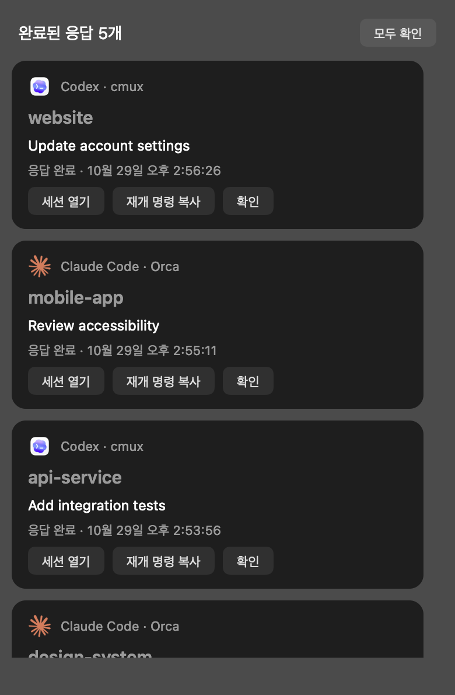

# 완료 알림

여러 Codex·Claude Code 세션의 완료 응답을 플로팅 카드로 표시합니다. 다른 앱과 전체 화면 Space에서도 보이며, **확인** 또는 **모두 확인**을 누를 때까지 유지됩니다. 패널을 원하는 모서리나 모니터로 드래그하면 위치를 기억합니다.

카드에는 서비스, 터미널, 프로젝트, 세션 이름과 완료 시각이 표시됩니다. 프로젝트 이름이나 **세션 열기**를 누르면 원래 세션으로 이동합니다. 이동만으로 확인 처리하지는 않습니다. 새 알림과 15초 간격의 작은 움직임으로 완료를 알리며, macOS의 **동작 줄이기** 설정을 켜면 움직임을 생략합니다. 목록이 길면 스크롤할 수 있습니다.



*실제 앱을 가상 세션으로 렌더링한 화면이며 계정·대화 데이터는 포함하지 않습니다.*

## 서비스 연결

1. 이 빌드의 AiQuotaBar를 계속 사용할 위치에 설치하고 실행해 둡니다.
2. 메뉴에서 **완료 알림 연결 → Codex / Claude Code → 연결…**을 선택합니다.
3. 대화 상자의 설정 파일 경로를 확인한 뒤 **연결**을 누릅니다.
4. 새 에이전트 세션을 시작합니다. **Codex는 `/hooks`에서 추가된 AiQuotaBar 항목을 검토하고 신뢰해야 합니다.** 앱은 이 절차를 우회하지 않습니다.
5. 응답이 끝나면 보통 약 2초 이내에 카드가 표시됩니다.

`~/.codex/hooks.json` 또는 `~/.claude/settings.json`에 `SessionStart`, `UserPromptSubmit`, `Stop` 명령 훅을 추가합니다. 다른 도구의 훅과 기존 설정은 유지하며, 변경 전 파일을 같은 폴더의 `*.aiquotabar-backup-<id>`에 백업합니다. 연결을 반복해도 훅이 중복되지 않습니다. **연결 해제…**는 AiQuotaBar 훅만 제거하며, 이후 새 세션을 시작해야 적용됩니다.

설치된 앱 실행 파일이 훅을 처리하므로 Python·Node·추가 데몬은 필요하지 않습니다. AiQuotaBar를 종료해도 훅은 완료를 저장하며, 다음 실행 때 미확인 목록을 복원합니다. 앱 위치를 옮겼다면 연결을 다시 설정하세요. 앱을 삭제하기 전에는 연결을 해제하세요.

## 사용자 지정 프로필·에이전트 관리 앱

메뉴에서는 **AiQuotaBar 실행 환경**의 `CODEX_HOME` / `CLAUDE_CONFIG_DIR`를 사용합니다. Finder는 셸의 환경 변수를 상속하지 않습니다. 별도 프로필을 사용하면 **에이전트를 실행하는 터미널에서** 아래 명령을 실행하세요.

```sh
AQB="/Applications/AiQuotaBar.app/Contents/MacOS/AiQuotaBar"
"$AQB" --install-completion-hooks codex
"$AQB" --install-completion-hooks claude
```

소스 설치라면 경로는 `$HOME/Applications/AiQuotaBar.app/Contents/MacOS/AiQuotaBar`입니다. 같은 환경에서 `--remove-completion-hooks codex` 또는 `--remove-completion-hooks claude`로 해제할 수 있습니다. 명령은 수정한 파일 경로를 출력합니다.

관리 앱이 매번 다시 생성하는 설정 파일에는 직접 연결하지 마세요. 해당 앱의 영구 훅 설정에서 위 세 이벤트에 `'<앱 실행 파일의 절대 경로>' --completion-hook codex` 또는 `claude`를 등록해야 합니다. 앱마다 프로필·훅 관리 방식이 다르므로 설치만으로 모든 관리 앱의 완료 감지가 자동 연결되지는 않습니다.

세션 이름은 실행 전 설정한 `AIQUOTABAR_SESSION_NAME`, 이벤트가 제공한 세션 이름, 짧은 세션 식별자 순서로 표시합니다.

```sh
AIQUOTABAR_SESSION_NAME="계정 설정 변경" codex
```

## 세션 이동 지원

| 환경 | 이 빌드의 이동 방식 | 조건 |
| --- | --- | --- |
| macOS Terminal | TTY로 기존 탭 선택 | 소유 프로세스의 수명도 검사해 재사용된 TTY를 거부합니다. macOS 자동화 권한이 필요할 수 있습니다. |
| iTerm2 | `iterm2:reveal`로 기존 세션 열기 | 에이전트 환경에 `ITERM_SESSION_ID`가 있어야 하며 iTerm2가 실행 중이어야 합니다. |
| Warp | `WARP_FOCUS_URL`로 원래 세션 열기 | URL을 제공하는 버전과 실행 중인 macOS 안정 버전 Warp가 필요합니다. |
| cmux | AppleScript `focus`로 정확한 surface 선택 | `CMUX_SURFACE_ID`, `CMUX_WORKSPACE_ID`와 AppleScript 지원 버전이 필요합니다. 소켓 접근을 무제한으로 바꾸지 않습니다. |
| Orca | `orca terminal switch`로 세션 선택 | `ORCA_TERMINAL_HANDLE`과 원래 프로필을 사용합니다. 만료된 handle을 폴더명으로 추측해 대체하지 않습니다. 네이티브 채팅은 설치된 Orca가 이 API에 노출하는 세션에 한정됩니다. |
| WezTerm | `wezterm cli activate-pane`으로 pane 선택 | `WEZTERM_PANE`을 사용하며 제공된 `WEZTERM_UNIX_SOCKET`도 보존합니다. |
| kitty | `kitten @ focus-window`로 pane 선택 | `KITTY_WINDOW_ID`, 로컬 `unix:` 방식의 `KITTY_LISTEN_ON`, 기존 원격 제어 허용 설정이 필요합니다. 앱이 kitty 설정을 바꾸지 않습니다. |
| Herdr | 현재 접속한 바깥 터미널과 Herdr 내부 pane 선택 | 아래 래퍼로 접속해야 합니다. 마지막으로 등록한 살아 있는 접속을 대상으로 합니다. |
| Ghostty, VS Code / Cursor 내장 터미널, tmux, screen, SSH | 완료 카드와 **재개 명령 복사** | 정확한 탭 이동은 미구현입니다. 별도 세션 연결·확장·원격 중계가 필요합니다. |

이동 대상은 미리 기록한 식별자로 찾으며, 현재 활성 탭·프로젝트 이름·화면 좌표로 추측하지 않습니다. 탭 종료, CLI 미설치, 자동화 권한 거부, 미지원 환경, 식별자 만료 시에는 이유를 표시하고 알림을 유지합니다. **재개 명령 복사**는 셸에 안전하게 인용한 명령을 복사만 하며 자동 실행하지 않습니다. URL 방식에서는 macOS가 URL을 접수한 사실까지만 알 수 있으므로, 열기에 성공했더라도 카드를 자동 확인 처리하지 않습니다.

### Herdr 접속

Herdr 서버는 처음 실행한 터미널보다 오래 살아 있을 수 있습니다. 이전 터미널 정보를 따라가지 않도록 AiQuotaBar를 통해 접속하세요.

```sh
AQB="/Applications/AiQuotaBar.app/Contents/MacOS/AiQuotaBar"
"$AQB" --run-herdr
# 이름이 있는 로컬 세션:
"$AQB" --run-herdr --session work
```

지원되는 바깥 터미널에서 실행하고, 그 안에서 훅이 연결된 Codex·Claude를 사용합니다. 래퍼는 바깥 터미널을 기록한 뒤 자신을 `herdr`로 교체합니다. 에이전트를 추가 생성하거나 입력을 가로채지 않습니다.

알림을 누르면 접속 프로세스의 수명과 Herdr 소켓 식별자를 검사하고, 내부 pane을 선택한 뒤 바깥 탭을 앞으로 표시합니다. 다른 터미널에서 재접속할 때도 래퍼를 사용하세요. 여러 클라이언트가 접속하면 마지막으로 등록한 살아 있는 클라이언트로 이동합니다. 서버가 재시작되면 이전 pane 이동은 차단하고 **재개 명령 복사**를 제공합니다. SSH 및 tmux·Herdr 안에 중첩된 접속은 래퍼에서 지원하지 않습니다.

## 완료의 의미

기본 연결은 주 에이전트의 `Stop` 훅, 즉 응답을 마치는 시점을 관찰합니다. **요청한 작업의 성공, 모든 백그라운드 작업의 종료, 다른 Stop 훅의 종료 승인을 검증하는 기능은 아닙니다.** 다른 Stop 훅이 에이전트에게 계속 작업하도록 할 수 있습니다. 세션 종료·중단·실패·하위 에이전트 종료만으로는 카드를 만들지 않습니다.

Codex에서 작업을 이어 가게 하는 Stop 훅을 사용한다면 확정된 [`agent-turn-complete` notify 이벤트](https://learn.chatgpt.com/docs/config-file/config-advanced#notifications)를 권장합니다. **기존 `notify` 설정이 없을 때만** Codex 설정의 최상위에 다음을 추가하세요.

```toml
notify = ["/Applications/AiQuotaBar.app/Contents/MacOS/AiQuotaBar", "--notify-codex"]
```

컨텍스트 수집을 위한 AiQuotaBar `SessionStart` / `UserPromptSubmit` 훅은 유지하고, 이 방식을 사용할 때는 AiQuotaBar의 `Stop` 항목을 제거하세요. 다른 도구가 `notify`를 쓰면 덮어쓰지 말고 별도 알림 스크립트에서 두 명령을 연결해야 합니다. AiQuotaBar는 `config.toml`을 자동 수정하지 않습니다. 동일 서비스·세션·turn ID의 중복 이벤트는 하나로 합칩니다.

prompt ID가 없는 구버전 Claude는 `UserPromptSubmit`에서 기록한 토큰을 사용합니다. 세션 중간에 연결해 해당 훅을 받지 못한 경우 응답 해시로 대체하며, 같은 내용의 응답을 중복으로 판단할 수 있습니다.

## 로컬 데이터와 문제 해결

`~/Library/Application Support/AiQuotaBar/Notifications/`에 완료 메타데이터·이동 식별자·Herdr 연결 정보를 저장합니다. 사용자 전용 권한으로 저장하며, 원자적 쓰기와 프로세스 잠금으로 동시 이벤트를 처리합니다. 프롬프트·응답 본문·인증 정보·터미널 출력은 저장하지 않으며 통계나 네트워크 수집도 없습니다.

미확인 알림은 만료되지 않습니다. 확인한 이벤트 식별자는 재실행 후 중복을 막기 위해 90일간 보관합니다. 화면에는 최대 100개를 표시하고, 확인하면 다음 항목을 보여 줍니다.

- **알림이 오지 않음:** 설정 경로, 새 세션 시작, Codex `/hooks` 신뢰 여부, 전체 훅 비활성화 여부를 확인하세요. 관리 앱과 같은 프로필에서 연결해야 합니다.
- **바로 이동하지 못함:** **재개 명령 복사**를 사용하고 지원 표·자동화 권한·기존 탭 상태를 확인하세요. Herdr는 래퍼로 접속해야 합니다.
- **저장 파일 오류:** 기존 파일을 조용히 초기화하지 않고 보존합니다. 앱을 종료하고 Notifications 폴더를 백업한 뒤 복구하세요.
- **앱 이동·삭제:** 모든 프로필에서 훅 연결을 먼저 해제하세요. 미확인 데이터는 Notifications 폴더를 따로 삭제하기 전까지 남습니다.

공식 계약: [Codex 훅](https://learn.chatgpt.com/docs/hooks), [Claude Code 훅](https://code.claude.com/docs/en/hooks), [cmux CLI](https://cmux.com/docs/api), [Orca CLI](https://www.onorca.dev/docs/cli/reference), [Herdr CLI](https://herdr.dev/docs/cli-reference/), [Herdr 소켓 API](https://herdr.dev/docs/socket-api/).
