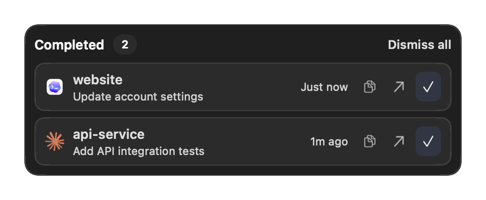

# Completion notifications

AiQuotaBar can show persistent completion cards for multiple Codex and Claude Code sessions. Cards float above other apps on the macOS primary display, appear across Spaces (including full-screen spaces), and remain until you choose **Dismiss** or **Dismiss all**. Drag the panel within the primary display; its position is remembered. A previous position on another display is moved back, and changing the primary display or disconnecting a monitor repositions the panel.

The inbox is an independent, borderless floating window; it does not send macOS Notification Center banners. Each compact 48-point card shows a provider icon, project, session label, and relative completion time. Hover over the icon for the provider and terminal, or the time for the exact date and time. Clicking the project or **↗ Open session** targets the original session without dismissing its card. The copy icon copies the resume command; **✓ Dismiss** acknowledges the card. All icon buttons have tooltips and accessibility labels. The window stays above other app windows and fits its cards without an internal scrollbar. Up to three cards fit on a page (fewer on a small display); previous/next buttons expose the rest.

The entire panel swings three times by ±3° around its top-right corner when new completions arrive and every 12 seconds afterward. Each movement takes 0.11 seconds. Dismissal stops the animation; macOS **Reduce motion** disables it, including when enabled while the animation is running.

Choose **Preview floating alert** in the menu to see and dismiss two clearly marked sample cards without running an agent. Preview cards are never stored, never count as unread completions, and have session navigation and command copying disabled. Real incoming completions replace the preview. **Show completions** also uses the custom panel when the inbox is empty.



*Rendered from the app using fictional sessions, with no account or conversation data.*

## Automatic connection

1. Install this build of AiQuotaBar in its permanent location and keep it running.
2. Installed Codex and Claude Code CLIs are connected automatically, without a menu action or setup dialog.
3. Start a new agent session. In Codex, open `/hooks` and review and trust the new AiQuotaBar hooks. Automatic registration does not grant Codex's separate hook trust.
4. Complete a response. The floating card normally appears within about two seconds.

The app adds `SessionStart`, `UserPromptSubmit`, and `Stop` command hooks to `~/.codex/hooks.json` or `~/.claude/settings.json`. Existing settings and other tools' hooks are preserved. Changed files receive a sibling `*.aiquotabar-backup-<id>` backup. Checks run at launch, once a minute, and on **Refresh now**. Unchanged settings are not rewritten or backed up again. Missing CLIs are skipped, including configuration creation; installing them later is detected on the next check.

Invalid JSON, symbolic-link configuration files, and globally disabled hooks are left intact. **Check notification connection…** appears in the menu when a connection fails. **Show completions** also explains connection status when there are no unread cards. Automatic connection does not install a CLI or sign into an account.

The hook executable is the installed app itself; no Python, Node, or extra daemon is required. Hooks save events even while AiQuotaBar is closed. The next launch restores the unread list. After moving the app, launch it from the new location to update hook paths automatically; Codex may require trust review again. Disconnect before deleting the app.

### Custom profiles and agent managers

Automatic setup uses `CODEX_HOME` / `CLAUDE_CONFIG_DIR` from **AiQuotaBar's launch environment**. Finder does not inherit shell exports. In a custom profile, run the following **from the terminal that launches the agent**, using your installed app path:

```sh
AQB="/Applications/AiQuotaBar.app/Contents/MacOS/AiQuotaBar"
"$AQB" --install-completion-hooks codex
"$AQB" --install-completion-hooks claude
```

For a source installation, use `$HOME/Applications/AiQuotaBar.app/Contents/MacOS/AiQuotaBar`. To disconnect a profile, use `--remove-completion-hooks codex` or `--remove-completion-hooks claude` in the same environment. This removes only AiQuotaBar hooks and writes a sibling `*.aiquotabar-disabled` marker so automatic checks do not reconnect that profile. An explicit install command re-enables it. Start a new agent session after either change. The command prints the configuration path. Do not run it against a manager's generated configuration if that manager recreates the file; use that manager's persistent hook settings instead, with the command `'<absolute app executable>' --completion-hook codex` (or `claude`) for the three events above.

Session names use `AIQUOTABAR_SESSION_NAME` when set before starting the agent, then an event-supplied session name, then a short session identifier. Example:

```sh
AIQUOTABAR_SESSION_NAME="Account settings" codex
```

## Terminal navigation

| Environment | Navigation in this build | Conditions |
| --- | --- | --- |
| macOS Terminal | Existing tab by TTY | Captures the owning process lifetime to reject reused TTYs; macOS Automation permission may be requested. |
| iTerm2 | Existing session via `iterm2:reveal` | Requires `ITERM_SESSION_ID` in the agent's environment and iTerm2 still running. |
| Warp | Existing session via `WARP_FOCUS_URL` | Requires a version supplying the focus URL; stable macOS Warp must be running. |
| cmux | Exact surface via its AppleScript `focus` command | Requires `CMUX_SURFACE_ID`, `CMUX_WORKSPACE_ID`, and a cmux version exposing AppleScript. Does not enable unrestricted socket access. |
| Orca | Runtime-issued terminal handle via `orca terminal switch` | Uses `ORCA_TERMINAL_HANDLE` and the originating profile. A stale handle produces an error; it is not guessed from the current project. Native chat support is limited to sessions the installed Orca exposes through this API. |
| WezTerm | Existing pane via `wezterm cli activate-pane` | Requires `WEZTERM_PANE`; preserves `WEZTERM_UNIX_SOCKET` when supplied. |
| kitty | Existing pane via `kitten @ focus-window` | Requires `KITTY_WINDOW_ID`, a local `unix:` `KITTY_LISTEN_ON`, and already-configured remote-control permission. AiQuotaBar does not change kitty settings. |
| Herdr | Current attached terminal plus the Herdr agent pane | Start Herdr using the wrapper below. The most recently registered live attachment is used. |
| Ghostty, VS Code / Cursor integrated terminal, tmux, screen, SSH | Completion cards and **Copy resume** | Exact-tab navigation is not implemented. These environments need additional session mapping or an extension/remote bridge. |

Navigation uses captured identifiers, never the frontmost tab, project name, or screen coordinates. A closed tab, unavailable CLI, denied Automation permission, unsupported environment, or expired handle leaves the card unread with an explanation. **Copy resume** copies a shell-quoted command; it does not execute it or create another session automatically. URL-based integrations can acknowledge only that macOS accepted the URL, not that the pane became visible, so opening a card never counts as dismissal.

### Herdr

Herdr's server can outlive the terminal that first started it. To avoid following stale inherited terminal IDs, attach through AiQuotaBar:

```sh
AQB="/Applications/AiQuotaBar.app/Contents/MacOS/AiQuotaBar"
"$AQB" --run-herdr
# Or a named local session:
"$AQB" --run-herdr --session work
```

Run this in a supported outer terminal, then launch Codex / Claude with the hooks connected. The wrapper records the outer terminal and replaces itself with `herdr`; it does not create an additional agent or intercept terminal input. On click, AiQuotaBar checks that attachment's process lifetime and the Herdr socket identity, selects the Herdr pane, and reveals the outer tab. Reattach with the wrapper after changing terminals. If several clients attach, the last registered live client is the destination. A server restart invalidates old pane destinations; use **Copy resume** rather than opening a potentially reused pane ID. SSH and nested tmux/Herdr attachments are not supported by this wrapper.

## What “finished” means

The default integration observes the main agent's `Stop` hook: the agent has reached the end of a response. This is **not a verification that the requested task succeeded**, all background jobs ended, or all other hooks permitted the agent to stop. A different Stop hook can continue work after AiQuotaBar is notified. Session exit, interruption, failure, and child-agent Stop events do not generate completion cards.

For Codex workflows with continuation hooks, prefer the finalized [`agent-turn-complete` notify event](https://learn.chatgpt.com/docs/config-file/config-advanced#notifications). Add this at the root of your Codex config **only if you do not already have a `notify` command**:

```toml
notify = ["/Applications/AiQuotaBar.app/Contents/MacOS/AiQuotaBar", "--notify-codex"]
```

Before switching to this advanced integration, run `--remove-completion-hooks codex` so automatic checks do not restore the `Stop` hook. The notify payload itself supplies Codex session and turn identity, and its process environment supplies the terminal destination. If another tool owns `notify`, chain the commands in your own notifier rather than replacing it. AiQuotaBar never rewrites `config.toml`. Hook and notify deliveries with the same provider/session/turn ID are deduplicated. Older Claude releases without a prompt ID use the token recorded at `UserPromptSubmit`; connecting mid-session without that hook falls back to a response hash and can collapse identical responses.

## Local data and troubleshooting

`~/Library/Application Support/AiQuotaBar/Notifications/` holds completion metadata, destination IDs, and local Herdr bindings. Files are user-only; writes are atomic and protected by a process lock. Prompt and assistant text, credentials, and terminal output are not saved. There is no analytics or network collector. Unread cards never expire; acknowledged event IDs are kept for 90 days to prevent replay after restart. All unread cards remain available through page controls; the panel fits its current page without scrolling.

- **No cards:** check the configuration path, start a new session, review Codex `/hooks`, and ensure hooks are not globally disabled. Test from the same profile used by the agent manager.
- **No direct navigation:** use **Copy resume**; check the table above, Automation permissions, and whether the original tab still exists. For Herdr, attach through `--run-herdr`.
- **Store error:** AiQuotaBar preserves an unreadable file rather than silently resetting it. Quit the app and back up the Notifications folder before repairing it.
- **Moving:** launch from the new location to update the automatic profile; reconnect custom profiles with the CLI. **Uninstalling:** disconnect hooks in every profile first. Unread metadata remains until you separately remove the Notifications folder.

Official contracts: [Codex hooks](https://learn.chatgpt.com/docs/hooks), [Claude Code hooks](https://code.claude.com/docs/en/hooks), [cmux CLI](https://cmux.com/docs/api), [Orca CLI](https://www.onorca.dev/docs/cli/reference), [Herdr CLI](https://herdr.dev/docs/cli-reference/), [Herdr socket API](https://herdr.dev/docs/socket-api/).
