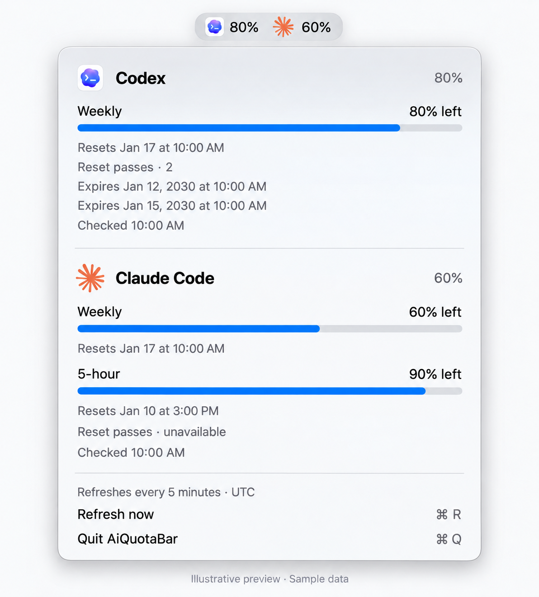

# AiQuotaBar

[English guide](README.md)

Codex와 Claude Code 사용량을 함께 확인하는 macOS 메뉴 막대 앱입니다.

<p align="center">
  
</p>

<p align="center"><em>두 서비스에 모두 로그인한 상태를 설명하는 영문 예시 화면입니다. 사용량, 날짜, 초기화권 정보는 모두 가상의 예시입니다.</em></p>

- 메뉴 막대에 서비스별 아이콘과 주간 잔여율을 표시합니다. 메뉴에서는 제공되는 세션·주간 한도를 확인할 수 있습니다.
- 다음 초기화 시각은 노트북의 현재 시간대로 표시합니다.
- Codex에서 제공하는 초기화권 개수와 각 유효기간을 표시합니다.
- 서비스별로 **설치 필요**, **로그인 필요** 상태를 구분합니다.
- 5분마다, 잠자기 해제 시, 또는 **⌘R**로 갱신합니다.
- Codex·Claude Code·OpenCode에 기록된 DeepSeek 등 서비스의 로컬 기록을 **API 환산 USD 추정액**과 서비스·모델별 내역으로 표시합니다. 가격을 모르면 추정 불가로 남기며 구독 청구액이 아닙니다. [기록 출처·개인정보·한계](Docs/UsageCosts.ko.md).
- 여러 Codex·Claude Code 세션의 완료를 유지되는 플로팅 카드와 애니메이션으로 알리고, 세션 이동·개별 확인을 제공합니다.
- 서비스가 계획을 제공하면 **설계 검토 · 5/7단계**와 작은 진행 막대를 표시하고, 마우스를 올리면 전체 목록을 보여줍니다. [진행도 연결 및 조건](Docs/Notifications.ko.md#세션-진행도).
- macOS의 첫 번째 선호 언어가 한국어이면 한국어, 그 외에는 영어를 사용합니다. 날짜는 선택된 언어와 현재 시간대를 따릅니다. 시스템 언어를 변경한 뒤에는 앱을 다시 실행해 주세요.

## 준비 사항

- Apple Silicon 또는 Intel Mac의 macOS 13 이상
- Swift, Python 3, Git, `make`가 포함된 Xcode Command Line Tools
- 사용량을 확인할 서비스의 [Codex CLI](https://developers.openai.com/codex/cli/) 또는 [Claude Code](https://code.claude.com/docs/en/quickstart) 설치 및 로그인. 두 서비스가 모두 없어도 앱은 실행됩니다.

## 커맨드로 설치

1. Apple 명령줄 도구가 없다면 아래 명령을 실행하고 설치가 끝날 때까지 기다립니다.

   ```sh
   xcode-select --install
   ```

2. 소스를 내려받고 설치합니다.

   ```sh
   git clone https://github.com/kyung-yeon/ai-quota-bar.git
   cd ai-quota-bar
   make install
   ```

   현재 Mac의 아키텍처로 빌드하고 테스트를 실행한 뒤 로컬 서명한 앱을 설치하고 실행합니다. 신규 설치는 `sudo` 없이 `~/Applications/AiQuotaBar.app`을 사용합니다. `~/Applications` 또는 `/Applications`에 기존 앱이 있으면 해당 위치에서 교체하므로 그 폴더의 쓰기 권한이 필요합니다. 두 곳에 모두 있으면 현재 자동 실행 항목이 가리키는 앱을 유지하고, 해당 항목이 없으면 사용자 폴더를 우선합니다.

3. 메뉴 막대의 Codex·Claude 아이콘을 클릭해 사용량을 확인합니다. Dock에는 표시되지 않습니다.

설치 프로그램은 `~/Library/LaunchAgents/local.kyungyeon.ai-quota-bar.plist`를 등록해 로그인할 때 자동 실행합니다. 기존 **Codex Weekly**와 두 Applications 폴더의 중복 사본을 정리하고, 설치용 `dist/AiQuotaBar.app`도 삭제해 설치된 앱 하나만 남깁니다. 앱 백업 사본은 남기지 않으며, 교체에 실패하면 이전 앱과 자동 실행 항목으로 복구를 시도합니다.

### 업데이트

기존 소스 폴더에서 실행합니다.

```sh
git pull --ff-only
make install
```

계정 설정과 알림 데이터는 유지됩니다.

설치하지 않고 개발용 앱 번들만 만들려면 `make package`를 실행합니다. 로컬 빌드에는 임시 서명을 적용하며, 앱의 `Contents/Resources/source/`에도 수정 가능한 소스를 포함합니다.

## 계정 연결

위 공식 가이드에서 CLI를 설치하고 로그인한 다음 AiQuotaBar의 **지금 새로고침**을 누르세요. 사용량 조회는 CLI의 기존 계정을 사용하며 별도 로그인이나 모델 실행 요청이 필요하지 않습니다.

| 표시 | 의미와 해결 방법 |
| --- | --- |
| 설치 필요 | 해당 CLI를 찾지 못했습니다. 설치 후 새로고침하세요. |
| 로그인 필요 | CLI에 로그인하거나 만료된 세션으로 다시 로그인하세요. |
| 키체인 접근 필요 | **Claude Code 키체인 접근 허용…**을 선택하고 macOS 권한 창에 응답하세요. |
| 한도 정보 제공 안 됨 | API 키 전용 계정 등 지원되는 구독 한도를 제공하지 않는 계정입니다. |
| 갱신 필요 | 조회 결과가 15분 이상 지났거나 초기화 시각이 지났습니다. |
| 연결 확인 필요 / 조회 시간 초과 | 네트워크를 확인한 뒤 다시 조회하세요. 다른 서비스는 독립적으로 동작합니다. |

표준 Homebrew 경로, `~/.local/bin`, 실행 환경의 `PATH`, nvm의 Node 설치 경로, `~/.claude/local/claude`를 확인합니다. 로컬 패키징은 빌드할 때 발견한 CLI 경로도 기록합니다. 다른 경로에 설치했다면 해당 CLI가 `PATH`에 포함된 터미널에서 빌드하세요. 사용자 지정 계정 설정에 필요한 환경 변수는 앱 실행 환경에도 전달해야 합니다. Finder는 셸 설정을 자동으로 상속하지 않습니다.

Fable 등 Claude 모델별 주간 한도는 계정의 사용량 응답에 해당 항목이 있을 때 표시합니다. 서버에서 제공한 모델명과 사용률을 사용하며, 전체 모델의 주간 한도로 누락된 모델 한도를 추정하지 않습니다. `limits[].kind = "weekly_scoped"`, `percent`, `scope.model.display_name`을 읽고, 모델 ID가 없거나 `is_active: false`여도 제공된 한도는 표시합니다. [Claude 사용량 스키마](https://code.claude.com/docs/en/agent-sdk/typescript#sdkusagereport)와 [OAuth 응답 관찰 내용](https://github.com/anthropics/claude-code/issues/73770)을 참고하세요. 응답에 모델별 항목이 없으면 해당 모델의 한도를 표시할 수 없습니다.

Claude 키체인 권한 창은 **Claude Code 키체인 접근 허용…**을 선택했을 때만 허용합니다. 앱 시작·주기적 갱신·잠자기 해제·**지금 새로고침 / ⌘R**에서는 대화상자 없이 조회하며, 권한이 필요하면 **키체인 접근 필요**로 표시합니다. 앱 업데이트나 Claude Code 인증 정보 변경으로 권한이 다시 필요할 수 있습니다. 로컬 빌드는 임시 서명하므로 앱을 다시 빌드하면 **항상 허용**이 유지되지 않을 수 있습니다. 앱이 키체인 접근 목록을 바꾸거나 인증 정보를 다른 저장소로 복사하지는 않습니다. [키체인 팝업 안내](Docs/ClaudeKeychain.ko.md).

## 완료 알림

AiQuotaBar를 실행하면 설치된 Codex·Claude Code CLI의 완료 알림이 자동으로 연결됩니다. 별도 연결 메뉴나 설정 대화 상자는 없으며, 연결 후 새 에이전트 세션을 시작하면 됩니다. Codex 자체의 보안 절차에 따라 `/hooks`에서 새 훅을 검토하고 신뢰하는 과정은 필요합니다. 플로팅 목록에는 열려 있는 세션도 표시합니다. 대기 중인 행은 회색, 작업 중인 행은 회전 표시로 구분하고, 확인이 필요한 완료는 애니메이션과 함께 맨 위로 올립니다. 서비스·세션별로 행 하나만 표시하며 새 완료가 오면 갱신합니다. 확인한 세션도 열려 있으면 대기 목록에 남습니다. 하위 에이전트는 부모 아래에 연결선과 들여쓰기로 표시하며, 제공된 모델 정보도 함께 보여줍니다. 프로젝트·세션·완료 시각이 표시된 카드는 확인할 때까지 유지되며 앱 재실행 후에도 복원됩니다. 세션 열기에 성공하면 해당 완료 알림도 함께 확인 처리합니다. 이동에 실패하거나 이동 중 새 응답이 도착한 경우에는 해당 알림을 미확인으로 유지합니다.

미확인 하위 에이전트는 세션이 종료되거나 앱을 재실행해도 부모 아래 트리를 유지합니다. `codex exec --ephemeral`로 확인되는 일회성 자동 작업은 명시적인 하위 에이전트 관계가 있는 경우를 제외하고 새 알림에서 제외합니다. 출처를 확인할 수 없는 기존 알림은 보존합니다.

플로팅 창의 가장자리나 오른쪽 아래 손잡이를 안쪽으로 드래그하면 줄어들고, 바깥쪽으로 드래그하면 커집니다. 기본 Mac 제목 표시줄은 창 본문에 붙어 있습니다. 사용자가 정한 크기와 위치는 갱신·재실행 후에도 유지합니다. 왼쪽 위의 기본 Mac 버튼으로 **닫기·최소화·확대/복원**할 수 있습니다. 닫기는 플로팅만 숨기며 수집과 미확인 데이터는 유지합니다. 최소화한 창은 새 응답이 와도 다시 나타나지 않으며, 상단 바의 **플로팅 열기**로 복원할 수 있습니다.

**설정 → 플로팅 설정 → 페이지 개수**에서 페이지당 1·2·3·5·10(기본)·15·20개를 선택할 수 있으며 설정은 저장됩니다. 카드가 길거나 창이 작으면 하단에 실제 표시 개수를 안내하며, 나머지는 이전·다음 버튼으로 확인합니다. 페이지를 넘겨도 창 크기와 하단 페이지 버튼 위치를 유지합니다. 마지막 페이지나 짧은 내용의 페이지는 남는 공간을 여백으로 둡니다. 카드 하나와 페이지 버튼이 잘리지 않도록 최소 창 크기를 제한합니다. 닫힌 창은 새 완료나 앱 재실행으로 자동으로 다시 열리지 않습니다.

**설정 → 투명도 → 0%~100%**에서 사용량 메뉴 창과 세션 플로팅 창의 투명도를 10% 단위로 조절할 수 있습니다. **0%는 불투명, 100%는 창·카드·메시지 배경과 블러를 없앤 투명 상태**입니다. 중간 값에서는 반투명 재질과 뒤쪽 화면이 섞여 보입니다. 글자·아이콘·입력 버튼은 그대로 유지합니다. 비율을 선택하면 투명도가 켜지고, **투명도 설정** 체크로 끄거나 저장된 값으로 다시 켤 수 있습니다(기본값: 70%). 설정은 재실행 후에도 유지하며, macOS의 **투명도 줄이기**를 켰다면 불투명 배경을 유지합니다.

각 세션 아래에 후속 요청 입력창을 제공합니다. 로컬 Orca 세션에는 작업 중에도 입력할 수 있습니다. **↑** 또는 **Enter**로 전송하고, **Shift+Enter**로 줄바꿈하며, **Tab**으로 다음 요청을 큐에 전달합니다. **⌘ Enter**도 전송 단축키로 유지합니다. 초안은 자동 갱신·페이지 이동 중 메모리에 유지하며, 닫힌 세션·지원하지 않는 환경·부모 터미널을 공유하는 하위 에이전트는 전송을 비활성화합니다. [직접 입력 안내](Docs/Notifications.ko.md#직접-입력)를 참고하세요.

알림은 처음에 메인 모니터에 표시됩니다. 상단이나 빈 배경을 드래그해 다른 모니터로 옮길 수 있으며, 새 알림이 오거나 앱을 다시 실행해도 옮긴 위치를 유지합니다. 해당 모니터의 연결을 해제하면 메인 모니터로 돌아옵니다.

기본 **AiQuotaBar 제목 표시줄** 또는 **AI 세션** 상단을 더블클릭하면 기본 창 버튼 아래에 제목·개수만 남도록 접힙니다. 다시 더블클릭하면 이전 크기로 펼쳐집니다. 접혀 있어도 세션 수집은 계속하며, 새 완료나 앱 재실행 후에도 접힌 상태를 유지합니다.

각 카드의 제목·진행도 아래에 최근 응답 또는 요청의 마지막 약 5줄을 표시합니다. 짧은 메시지는 공간을 적게 사용하고, 카드가 길어지면 한 페이지의 행 수를 줄여 화면 안에 맞춥니다. 로컬 Orca는 이미 열린 탭에서 제공하는 메시지도 표시하며, 다른 환경은 연결된 훅으로 수집합니다. 메시지가 없으면 기존의 간결한 행을 유지합니다. 전체 대화 기록 대신 짧은 미리보기 하나만 로컬에 보관합니다.

오른쪽의 **전체 n개 · 완료 n건 · 작업 중 n건** 태그를 누르면 목록을 필터링하며, 선택한 태그를 강조합니다. 숫자는 항상 전체 목록 기준입니다. 필터를 바꿔도 창 크기와 초안을 유지하고, 조건에 맞는 하위 에이전트의 부모 관계도 함께 표시합니다. **전체**를 누르면 모든 세션으로 돌아옵니다.

**완료** 태그 바로 오른쪽의 **모두 확인**을 누르면 페이지·필터와 관계없이 작업 중인 세션을 제외한 미확인 완료 응답을 일괄 확인합니다. 작업 중인 세션의 미확인 상태와 이후 새로 도착한 응답은 그대로 유지합니다. 접힌 창에서도 사용할 수 있으며 확인할 수 있는 완료 응답이 없으면 비활성화됩니다.

상단에 전체 세션과 하위 에이전트 기준의 **완료 n건**(아직 확인하지 않은 응답)과 **작업 중 n건**(현재 실행 중인 열린 세션)을 태그로 표시합니다. 접힌 상태에서도 보이며 입력 중에도 갱신됩니다. 이전 응답을 확인하지 않고 새 작업이 진행 중인 세션은 두 집계에 모두 포함됩니다.

기본 OS 알림 배너와 별개인 자체 플로팅 창입니다. 카드의 헤더 높이는 48pt이며 그 아래에 메시지와 입력창을 배치합니다. 서비스 아이콘·프로젝트·세션·완료 시각과 작은 동작 버튼을 표시합니다. 완료된 행은 0.6초 동안 부드럽게 위로 이동합니다. 완료 후 아직 확인하지 않은 항목이 있을 때만 상단 완료 태그가 주기적으로 흔들리며, 작업 중·대기 항목만 있으면 흔들리지 않습니다. ‘동작 줄이기’ 설정을 따릅니다.

Terminal, iTerm2, Warp, cmux, Orca, WezTerm, 설정된 kitty 세션의 직접 이동을 구현했습니다. Herdr는 바깥 터미널을 정확히 찾기 위한 접속 래퍼가 필요합니다. 지원하지 않거나 닫힌 탭은 이유를 표시하며, 원래 터미널에서 직접 열거나 재개해야 합니다. 자동 연결은 기존 훅을 보존하고 변경되는 설정 파일을 백업합니다. 설치되지 않은 도구는 건너뛰고 나중에 설치하면 감지하며, 잘못된 설정이나 비활성화된 훅은 그대로 두고 연결 문제로 표시합니다.

버전·환경별 조건, Herdr 접속, 사용자 지정 프로필, 완료의 의미와 데이터 보관 방식은 [완료 알림 가이드](Docs/Notifications.ko.md)를 참고하세요.

## 초기화권과 데이터 출처

**Codex:** `codex app-server --stdio`의 `account/read`, `account/rateLimits/read`를 사용합니다. 초기화권 수는 서버의 전체 개수를 기준으로 하며 세부 목록은 일부만 제공될 수 있습니다. 만료되거나 사용한 초기화권은 유효기간 목록에서 제외합니다. 날짜를 제공하지 않으면 그 상태를 표시하고, 유효기간이 null인 권한은 만료 제한 없음으로 표시합니다. 초기화권을 조회만 하며 사용하지 않습니다. [공식 app-server 문서](https://learn.chatgpt.com/docs/app-server#6-rate-limits-chatgpt)를 참고하세요.

**Claude Code:** macOS 키체인의 기존 OAuth 인증 정보를 읽고, 필요하면 Claude Code의 `.credentials.json` 저장 방식으로 대체합니다. 앱 실행 환경에 설정된 `CLAUDE_CONFIG_DIR`별 키체인 이름과 `CLAUDE_CODE_OAUTH_TOKEN`도 지원합니다. 공식 CLI가 사용하는 `https://api.anthropic.com/api/oauth/usage`에서 `five_hour`, `seven_day` 사용률을 조회합니다. 안정성이 보장된 공개 API가 아닌 내부 엔드포인트이므로 변경 시 앱 업데이트가 필요할 수 있습니다. 인증 정보 저장 방식은 [Claude Code 인증 문서](https://code.claude.com/docs/en/authentication)를 참고하세요.

현재 구현에서 Claude 초기화권의 응답 형식은 확인되지 않아 **정보 제공 안 됨**으로 표시합니다. 정보가 없는 상태를 0장으로 처리하지 않으며 유료 추가 사용 크레딧도 초기화권으로 간주하지 않습니다. Claude 사용량은 로그인한 구독 계정이 필요합니다. 개발 Mac에는 Claude CLI가 없어 실제 Claude 계정 조회는 검증하지 못했습니다.

인증 정보와 사용량 응답은 로그나 앱 번들에 저장하지 않습니다. Claude 인증 정보는 메모리에서만 읽어 Anthropic 사용량 엔드포인트로 전송하고 리디렉션은 거부합니다. Codex 인증은 Codex가 처리합니다. 네트워크 오류는 로그인 필요 상태와 구분합니다.

## 개발 및 검증

```sh
make test                         # 오프라인 응답 파싱·상태 테스트
make check                        # 실제 계정 사용량 읽기 전용 조회
./build/AiQuotaBar --smoke-test     # 메뉴 막대 생성·조회·상태 출력 후 종료
./build/AiQuotaBar --self-test --language en
./build/AiQuotaBar --self-test --language ko
./build/AiQuotaBar --completion-ui-test --language ko  # 샘플 UI·저장 검증, 실제 에이전트 호출 없음
```

샘플 데이터로 화면을 렌더링할 수 있습니다. 아래 화면의 수치는 실제 계정 사용량이 아닙니다.

```sh
./build/AiQuotaBar --preview-demo --language en --preview /tmp/aiquota-en.png
./build/AiQuotaBar --preview-demo --language ko --dark --preview /tmp/aiquota-ko.png
./build/AiQuotaBar --preview-completions /tmp/completions-en.png --language en
./build/AiQuotaBar --preview-completions /tmp/completions-ko.png --language ko --dark
```

구현: `Sources/` · 테스트: `Tests/` · 진입점: `main.swift` · 패키징: `package.py` · 설치: `install.py`. 세션 수명 테스트는 임시 로컬 Unix 소켓을 사용하며, UI 테스트에는 로그인된 macOS 데스크톱 세션이 필요합니다.

## 자동 실행 해제 및 삭제

앱을 삭제하기 전에 실행 파일의 `--remove-completion-hooks codex`와 `--remove-completion-hooks claude`를 서비스·사용자 지정 프로필마다 실행하세요([해제 명령](Docs/Notifications.ko.md#사용자-지정-프로필에이전트-관리-앱)). 미확인 알림 메타데이터는 `~/Library/Application Support/AiQuotaBar/Notifications/`에 별도로 남습니다.

**AiQuotaBar 종료**는 현재 실행만 종료합니다. 다음 로그인에서도 실행하지 않으려면:

```sh
launchctl bootout "gui/$(id -u)/local.kyungyeon.ai-quota-bar"
rm "$HOME/Library/LaunchAgents/local.kyungyeon.ai-quota-bar.plist"
```

`bootout`에서 서비스를 찾을 수 없다고 하면 이미 종료된 상태입니다. 완전히 삭제하려면 설치할 때 출력된 경로(`~/Applications` 또는 `/Applications`)의 `AiQuotaBar.app`을 휴지통으로 이동하세요. Codex·Claude 설치와 계정은 영향을 받지 않습니다.

## 라이선스

AiQuotaBar의 자체 코드와 문서는 [MIT 라이선스](LICENSE)로 제공됩니다. 저작권 및 라이선스 고지를 유지하면 누구나 상업적 목적을 포함하여 자유롭게 사용·수정·재배포할 수 있습니다. 소프트웨어는 보증 없이 제공됩니다.

외부 서비스의 아이콘과 상표는 각 소유자에게 권리가 있으며 이 MIT 라이선스의 적용 대상이 아닙니다. [서비스 아이콘 출처](Assets/README.md)를 참고하세요.
