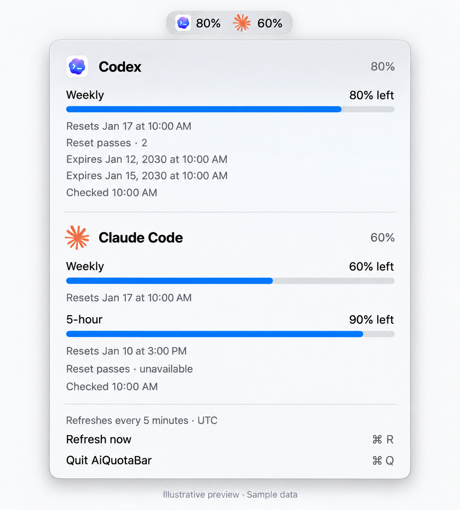

# AiQuotaBar

[English guide](README.md)

Codex와 Claude Code 사용량을 함께 확인하는 macOS 메뉴 막대 앱입니다.

<p align="center">
  
</p>

<p align="center"><em>두 서비스에 모두 로그인한 상태를 설명하는 영문 예시 화면입니다. 사용량, 날짜, 초기화권 정보는 모두 가상의 예시입니다.</em></p>

- 메뉴 막대에 서비스별 아이콘과 주간 잔여율을 표시합니다. 메뉴에서는 제공되는 세션·주간 한도를 확인할 수 있습니다.
- 다음 초기화 시각은 노트북의 현재 시간대로 표시합니다.
- Codex에서 제공하는 초기화권 개수와 각 유효기간을 표시합니다.
- 서비스별로 **설치 필요**, **로그인 필요** 상태를 구분합니다.
- 5분마다, 잠자기 해제 시, 또는 **⌘R**로 갱신합니다.
- macOS의 첫 번째 선호 언어가 한국어이면 한국어, 그 외에는 영어를 사용합니다. 날짜는 선택된 언어와 현재 시간대를 따릅니다. 시스템 언어를 변경한 뒤에는 앱을 다시 실행해 주세요.

## 준비 사항

- Apple Silicon 또는 Intel Mac의 macOS 13 이상
- 소스에서 빌드할 때만 Swift, Python 3, `make`가 포함된 Xcode Command Line Tools가 필요합니다. DMG 설치에는 필요하지 않습니다.
- 사용량을 확인할 서비스의 [Codex CLI](https://developers.openai.com/codex/cli/) 또는 [Claude Code](https://code.claude.com/docs/en/quickstart) 설치 및 로그인. 두 서비스가 모두 없어도 앱은 실행됩니다.

## DMG로 설치

**[macOS용 AiQuotaBar 다운로드](https://github.com/kyung-yeon/ai-quota-bar/releases/download/v0.1.0/AiQuotaBar-0.1.0-universal.dmg)** · [전체 릴리스 및 체크섬](https://github.com/kyung-yeon/ai-quota-bar/releases)

1. DMG를 열고 **AiQuotaBar.app**을 **Applications**로 드래그합니다.
2. DMG를 추출한 뒤 응용 프로그램에서 AiQuotaBar를 실행합니다.
3. 메뉴 막대의 아이콘을 클릭해 사용량을 확인합니다. Dock에는 표시되지 않습니다.

DMG를 열면 왼쪽의 AiQuotaBar와 오른쪽의 Applications가 작은 설치 창에 표시됩니다. 화살표 방향으로 앱을 끌어 복사하세요. 하나의 앱이 Apple Silicon·Intel을 모두 지원하며, 앱 번들 안에 영문·한국어 설치 안내가 포함됩니다. 로그인할 때 실행하려면 **시스템 설정 → 일반 → 로그인 항목 → 로그인 시 열기**에 설치된 앱을 추가하세요. 드래그 설치는 자동 실행을 등록하지 않습니다.

**기존 설치 업데이트:** AiQuotaBar를 종료하고 기존 폴더의 앱을 교체하세요. `make install`로 설치했다면 `~/Applications/AiQuotaBar.app`을 그 위치에서 교체해야 기존 자동 실행이 유지됩니다. `/Applications`에 다른 사본을 만들지 마세요.

**처음 실행할 때:** 이 배포본은 임시 서명을 사용하며 **Apple 공증을 받지 않았습니다**. macOS가 차단하면 먼저 이 프로젝트의 Releases에서 받은 파일인지 확인하세요. 배포본을 신뢰한다면 앱 실행을 시도한 뒤 **시스템 설정 → 개인정보 보호 및 보안 → 그래도 열기**를 이용할 수 있습니다. [Apple 안내](https://support.apple.com/ko-kr/102445)를 참고하세요.

## 소스에서 설치

1. Apple 명령줄 도구가 없다면 설치합니다.

   ```sh
   xcode-select --install
   ```

2. 터미널에서 이 소스 폴더로 이동한 뒤 실행합니다.

   ```sh
   make install
   ```

   현재 Mac의 아키텍처로 빌드하고 테스트를 실행한 뒤 로컬 서명한 앱을 `~/Applications/AiQuotaBar.app`에 설치하고 실행합니다. `sudo`는 필요하지 않습니다.

3. 메뉴 막대의 Codex·Claude 아이콘을 클릭해 사용량을 확인합니다. Dock에는 표시되지 않습니다.

설치 프로그램은 `~/Library/LaunchAgents/local.kyungyeon.ai-quota-bar.plist`를 등록해 로그인할 때 자동 실행합니다. 기존 `~/Applications/Codex Weekly.app`이 있다면 해당 앱과 자동 실행 항목을 교체합니다. 이전 앱과 자동 실행 파일은 `~/Library/Application Support/AiQuotaBar/Backups/`에 보관하며, 설치 실패 시 이전 상태로 복구를 시도합니다.

설치하지 않고 앱 번들만 만들려면:

```sh
make package
open dist/AiQuotaBar.app
```

로컬 빌드에는 임시 서명을 적용합니다. 앱의 `Contents/Resources/source/`에도 수정 가능한 소스를 포함합니다.

## 계정 연결

위 공식 가이드에서 CLI를 설치하고 로그인한 다음 AiQuotaBar의 **지금 새로고침**을 누르세요. 앱은 CLI의 기존 계정을 사용하며 별도 로그인 화면이나 모델 실행 요청은 만들지 않습니다.

| 표시 | 의미와 해결 방법 |
| --- | --- |
| 설치 필요 | 해당 CLI를 찾지 못했습니다. 설치 후 새로고침하세요. |
| 로그인 필요 | CLI에 로그인하거나 만료된 세션으로 다시 로그인하세요. |
| 키체인 접근 필요 | **Claude Code 키체인 접근 허용…**을 선택하고 macOS 권한 창에 응답하세요. |
| 한도 정보 제공 안 됨 | API 키 전용 계정 등 지원되는 구독 한도를 제공하지 않는 계정입니다. |
| 갱신 필요 | 조회 결과가 15분 이상 지났거나 초기화 시각이 지났습니다. |
| 연결 확인 필요 / 조회 시간 초과 | 네트워크를 확인한 뒤 다시 조회하세요. 다른 서비스는 독립적으로 동작합니다. |

표준 Homebrew 경로, `~/.local/bin`, 실행 환경의 `PATH`, nvm의 Node 설치 경로, `~/.claude/local/claude`를 확인합니다. 로컬 패키징은 빌드할 때 발견한 CLI 경로도 기록하지만 배포용 DMG에는 제작한 Mac의 경로를 넣지 않습니다. 다른 경로에 설치했다면 해당 CLI가 `PATH`에 포함된 터미널에서 빌드하세요. 사용자 지정 계정 설정에 필요한 환경 변수는 앱 실행 환경에도 전달해야 합니다. Finder는 셸 설정을 자동으로 상속하지 않습니다.

## 초기화권과 데이터 출처

**Codex:** `codex app-server --stdio`의 `account/read`, `account/rateLimits/read`를 사용합니다. 초기화권 수는 서버의 전체 개수를 기준으로 하며 세부 목록은 일부만 제공될 수 있습니다. 만료되거나 사용한 초기화권은 유효기간 목록에서 제외합니다. 날짜를 제공하지 않으면 그 상태를 표시하고, 유효기간이 null인 권한은 만료 제한 없음으로 표시합니다. 초기화권을 조회만 하며 사용하지 않습니다. [공식 app-server 문서](https://learn.chatgpt.com/docs/app-server#6-rate-limits-chatgpt)를 참고하세요.

**Claude Code:** macOS 키체인의 기존 OAuth 인증 정보를 읽고, 필요하면 Claude Code의 `.credentials.json` 저장 방식으로 대체합니다. 앱 실행 환경에 설정된 `CLAUDE_CONFIG_DIR`별 키체인 이름과 `CLAUDE_CODE_OAUTH_TOKEN`도 지원합니다. 공식 CLI가 사용하는 `https://api.anthropic.com/api/oauth/usage`에서 `five_hour`, `seven_day` 사용률을 조회합니다. 안정성이 보장된 공개 API가 아닌 내부 엔드포인트이므로 변경 시 앱 업데이트가 필요할 수 있습니다. 인증 정보 저장 방식은 [Claude Code 인증 문서](https://code.claude.com/docs/en/authentication)를 참고하세요.

현재 구현에서 Claude 초기화권의 응답 형식은 확인되지 않아 **정보 제공 안 됨**으로 표시합니다. 정보가 없는 상태를 0장으로 처리하지 않으며 유료 추가 사용 크레딧도 초기화권으로 간주하지 않습니다. Claude 사용량은 로그인한 구독 계정이 필요합니다. 개발 Mac에는 Claude CLI가 없어 실제 Claude 계정 조회는 검증하지 못했습니다.

인증 정보와 사용량 응답은 로그나 앱 번들에 저장하지 않습니다. Claude 인증 정보는 메모리에서만 읽어 Anthropic 사용량 엔드포인트로 전송하고 리디렉션은 거부합니다. Codex 인증은 Codex가 처리합니다. 네트워크 오류는 로그인 필요 상태와 구분합니다.

## 개발 및 검증

```sh
make test                         # 오프라인 응답 파싱·상태 테스트
make check                        # 실제 계정 사용량 읽기 전용 조회
./build/AiQuotaBar --smoke-test     # 메뉴 막대 생성·조회·상태 출력 후 종료
./build/AiQuotaBar --self-test --language en
./build/AiQuotaBar --self-test --language ko
```

샘플 데이터로 화면을 렌더링할 수 있습니다. 아래 화면의 수치는 실제 계정 사용량이 아닙니다.

```sh
./build/AiQuotaBar --preview-demo --language en --preview /tmp/aiquota-en.png
./build/AiQuotaBar --preview-demo --language ko --dark --preview /tmp/aiquota-ko.png
```

구현: `Sources/` · 테스트: `Tests/` · 진입점: `main.swift` · 패키징: `package.py` · 설치: `install.py`.

배포용 DMG를 만들려면:

```sh
make dmg
```

두 아키텍처를 빌드해 `dist/AiQuotaBar-0.1.0-universal.dmg`와 `.dmg.sha256` 체크섬을 생성합니다. 압축 전에 Finder로 창 크기·배경·아이콘 위치를 저장하므로 로그인된 macOS 데스크톱 세션에서 실행하세요. macOS가 요청하면 터미널의 Finder 제어를 허용합니다. 디스크 이미지 검증, 읽기 전용 마운트, 두 아키텍처·앱 서명·저장된 배치 확인, 마운트된 앱의 오프라인 테스트, 디스크 추출까지 수행하며 앱을 설치하거나 메뉴 막대에 실행하지 않습니다. 배포 패키징은 `dmg.py`, 배치 도구는 `Tools/`, 설치 안내는 `Docs/`에 있습니다.

## 자동 실행 해제 및 삭제

**AiQuotaBar 종료**는 현재 실행만 종료합니다. 다음 로그인에서도 실행하지 않으려면:

```sh
launchctl bootout "gui/$(id -u)/local.kyungyeon.ai-quota-bar"
rm "$HOME/Library/LaunchAgents/local.kyungyeon.ai-quota-bar.plist"
```

`bootout`에서 서비스를 찾을 수 없다고 하면 이미 종료된 상태입니다. 완전히 삭제하려면 `~/Applications/AiQuotaBar.app`도 휴지통으로 이동하세요. `~/Library/Application Support/AiQuotaBar/Backups/`의 백업은 복구용으로 보관하거나 별도로 삭제할 수 있습니다. Codex·Claude 설치와 계정은 영향을 받지 않습니다.

## 라이선스

AiQuotaBar의 자체 코드와 문서는 [MIT 라이선스](LICENSE)로 제공됩니다. 저작권 및 라이선스 고지를 유지하면 누구나 상업적 목적을 포함하여 자유롭게 사용·수정·재배포할 수 있습니다. 소프트웨어는 보증 없이 제공됩니다.

외부 서비스의 아이콘과 상표는 각 소유자에게 권리가 있으며 이 MIT 라이선스의 적용 대상이 아닙니다. [서비스 아이콘 출처](Assets/README.md)를 참고하세요.
